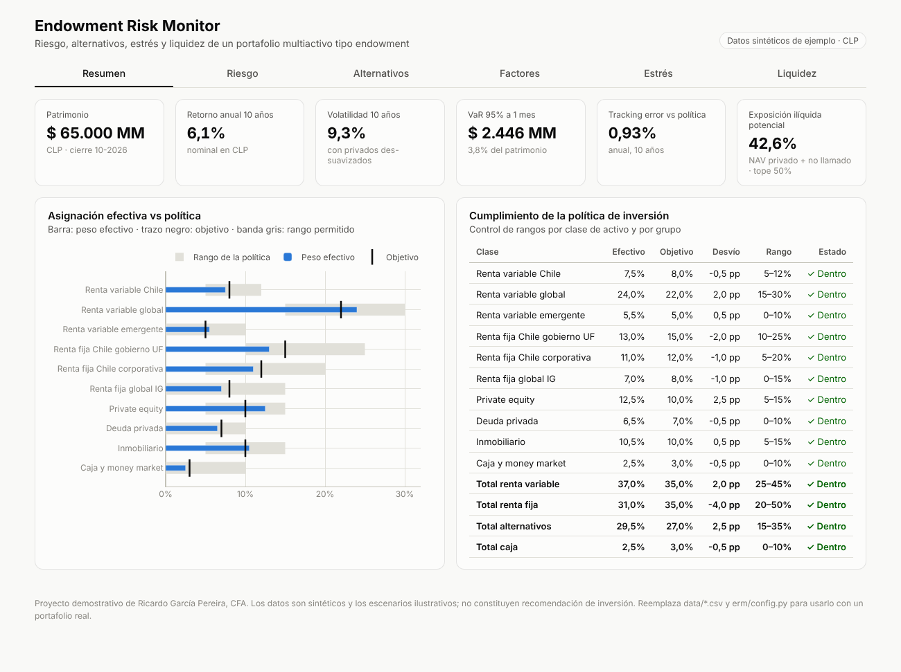
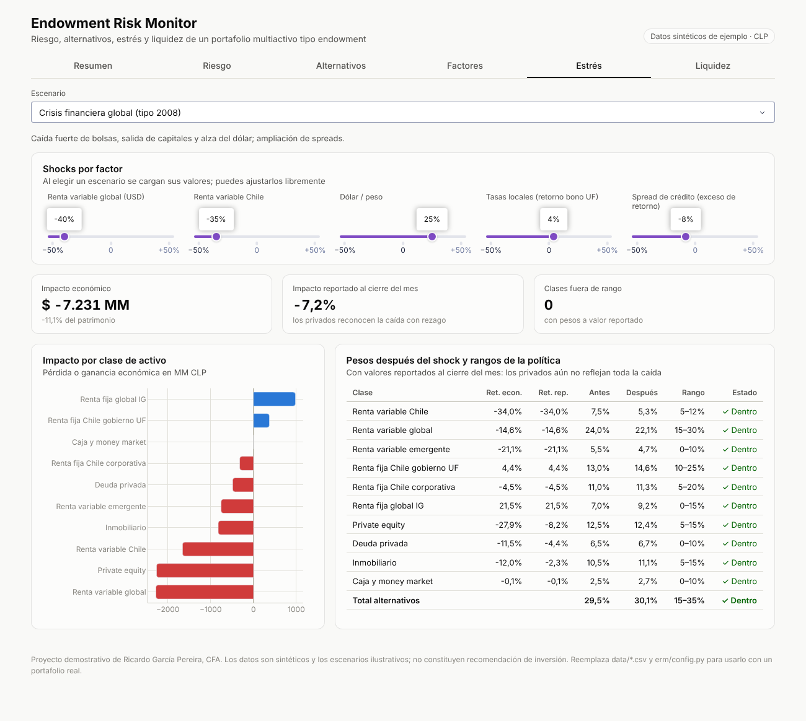
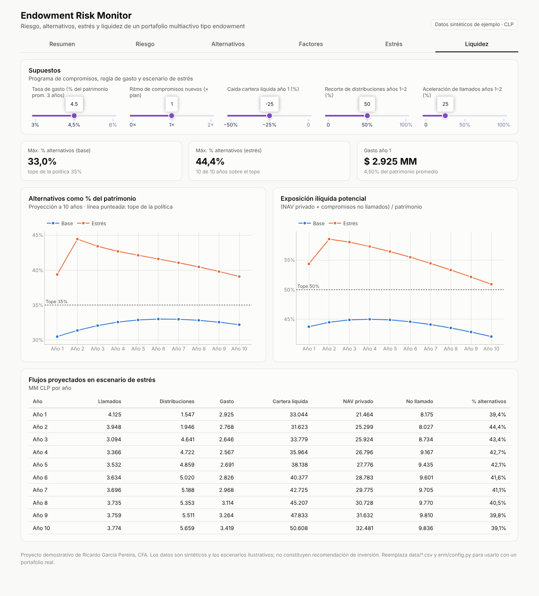

# Endowment Risk Monitor

Dashboard en Python/Dash para medir el **riesgo, la exposición a alternativos, el impacto de escenarios de estrés y la liquidez** de un portafolio multiactivo tipo endowment, con moneda base CLP.

El proyecto aborda tres problemas que los comités de inversión suelen subestimar cuando el portafolio tiene activos privados:

1. **El suavizamiento de la tasación.** El private equity, la deuda privada y el inmobiliario se valorizan por tasación, que incorpora el valor de mercado con rezago. Medido así, el riesgo del portafolio se ve menor de lo que es y los alternativos parecen más diversificadores de lo que son.
2. **El efecto denominador.** En una crisis cae primero lo líquido. Los privados, todavía a valor de tasación, suben como porcentaje del total y pueden superar los rangos de la política sin que se haya comprado nada.
3. **La liquidez de los compromisos.** Los compromisos no llamados son una obligación futura. Un shock de mercado combinado con menos distribuciones y llamados más rápidos puede tensionar la caja y la regla de gasto.



## Qué muestra cada pestaña

| Pestaña | Contenido |
|---|---|
| **Resumen** | Patrimonio, retorno, volatilidad, VaR, tracking error y exposición ilíquida potencial. Asignación efectiva vs objetivo y rangos, con control de cumplimiento por clase y por grupo. |
| **Riesgo** | Volatilidad, VaR y CVaR históricos al 95% y 99%, VaR paramétrico, máxima caída y Sharpe. Contribución de cada clase al riesgo total, volatilidad móvil de 36 meses (reportada vs des-suavizada) y drawdown. Ventanas de 3, 5 y 10 años o toda la historia. |
| **Alternativos** | Des-suavizamiento de Geltner por clase privada: coeficiente ρ, volatilidad, correlación con la renta variable global y máxima caída, reportadas vs económicas. |
| **Factores** | Regresión de cada clase sobre cinco factores (renta variable global, renta variable Chile, USD/CLP, tasas locales y crédito), con R² y la exposición agregada del portafolio. |
| **Estrés** | Cuatro escenarios ilustrativos (2008, 2020, 2022 y octubre de 2019) más uno personalizado. Impacto económico vs reportado y pesos posteriores al shock contra los rangos de la política. |
| **Liquidez** | Proyección a 10 años del programa de compromisos (modelo de Takahashi-Alexander simplificado), la regla de gasto y las donaciones, en escenario base y de estrés. |



## Metodología

**Des-suavizamiento (Geltner, 1993).** Si el retorno reportado sigue `r_rep(t) = ρ·r_rep(t−1) + (1−ρ)·r_true(t)`, el retorno económico se recupera como:

```
r_true(t) = (r_rep(t) − ρ·r_rep(t−1)) / (1 − ρ)
```

ρ se estima como la autocorrelación de primer orden de la serie reportada. La media se conserva, mientras que la volatilidad y las correlaciones aumentan.

**Contribución al riesgo.** `RC_i = w_i · (Σw)_i / σ_p`. Las contribuciones suman la volatilidad del portafolio.

**Estrés.** El retorno de cada clase es `Σ_k β_ik · shock_k`, con betas estimadas sobre retornos des-suavizados. Para el control de rangos se usan valores reportados al cierre del mes: los activos líquidos reflejan el shock completo, los privados solo la fracción `(1 − ρ)`.

**Liquidez.** Por cada programa privado: `llamados = tasa_llamado × no_llamado`, `distribuciones = tasa_distribución × NAV × (1+g)` y `NAV_t = NAV_{t−1}(1+g) + llamados − distribuciones`. El gasto es un porcentaje del patrimonio promedio de los últimos 3 años.



## Cómo ejecutarlo

```bash
git clone https://github.com/Rifegape/endowment-risk-monitor.git
cd endowment-risk-monitor
python -m venv .venv && source .venv/bin/activate   # en Windows: .venv\Scripts\activate
pip install -r requirements-dev.txt
python app.py                                        # abre http://127.0.0.1:8050
pytest -q                                            # 9 pruebas del motor de cálculo
```

### Publicar en Render

1. Sube el repositorio a GitHub.
2. En Render: **New → Blueprint** y selecciona el repositorio. El archivo `render.yaml` configura el servicio, que arranca con `gunicorn app:server`.

## Adaptarlo a un portafolio real

- **Portafolio y política:** en `erm/config.py` se definen las clases de activos, los pesos efectivos y objetivo, los rangos, los límites por grupo, los compromisos no llamados, la regla de gasto y los escenarios.
- **Datos:** reemplaza `data/factor_returns.csv` y `data/asset_returns.csv` por series mensuales propias con el mismo formato (fecha en la primera columna y un retorno decimal por columna). Para los privados, usa los retornos reportados; el monitor los des-suaviza.

## Estructura

```
app.py               Dashboard (layout y callbacks)
erm/config.py        Portafolio, política, compromisos y escenarios
erm/data.py          Carga de datos y generador sintético reproducible
erm/desmoothing.py   Geltner y estimación de ρ
erm/risk.py          Volatilidad, VaR/CVaR, drawdown, contribución al riesgo, tracking error
erm/factors.py       Regresión de factores y exposición del portafolio
erm/stress.py        Shocks por factor y efecto denominador
erm/liquidity.py     Proyección de compromisos, gasto y liquidez
tests/               Pruebas unitarias del motor
```

## Aviso

Los datos incluidos son **sintéticos**: se generaron con un modelo de factores con colas gruesas y episodios de crisis estilizados, con semilla fija para que los resultados sean reproducibles. Los escenarios de estrés son ilustrativos y deben calibrarse con datos propios. Nada de esto constituye una recomendación de inversión.

---

Ricardo García Pereira, CFA · [GitHub](https://github.com/Rifegape)
